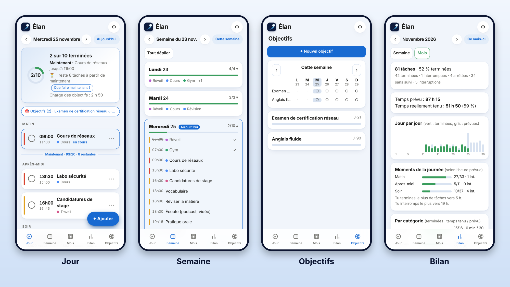
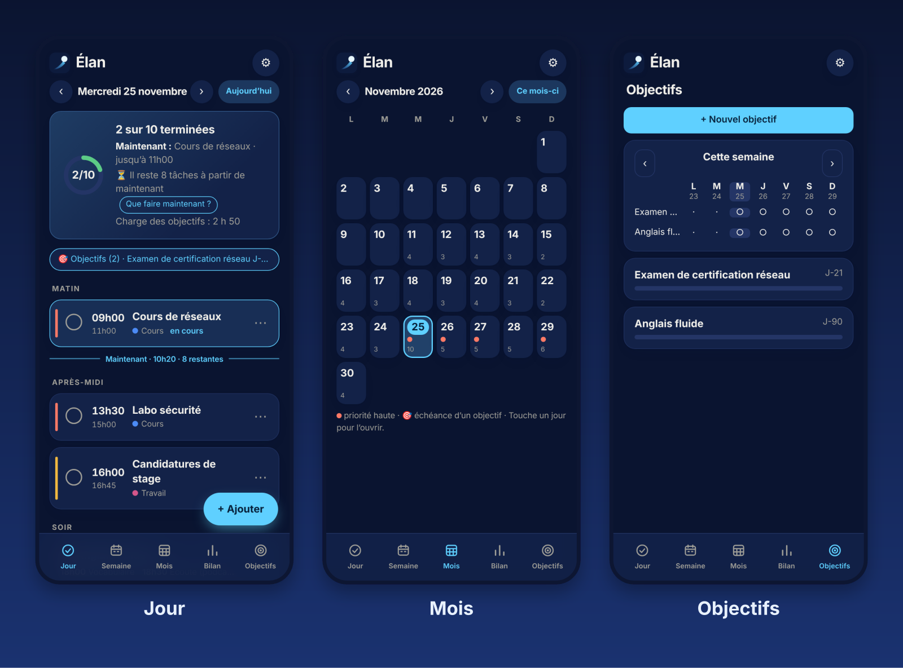

# Élan

[](https://github.com/gghost0011-boop/elan/actions/workflows/tests.yml)

**Planificateur de journée installable (PWA), sans serveur, sans compte, sans dépendance.**
Tâches, objectifs, discipline et bilan, dans une seule application qui fonctionne hors ligne et s'installe sur l'écran d'accueil.

**Essayer l'application : https://gghost0011-boop.github.io/elan/**
Ouvrir le lien sur un téléphone, puis « Ajouter à l'écran d'accueil ».





> *English summary:* Élan is a dependency-free, installable daily planner built with vanilla JavaScript. It runs entirely in the browser (no backend, no account), works offline through a service worker, and stores data locally. It supports goals with discipline tracking, weekly and monthly views, stats, calendar export, and 8 interface languages (including right-to-left Arabic). Open the link above on a phone and choose "Add to Home Screen".

## Fonctionnalités

**Planifier sa journée**
- Tâches avec heure, durée (jusqu'à 12 h), priorité, catégorie, notes et sous-tâches
- Heure précise sans durée (par exemple un réveil à 5 h)
- Répétition par jour de la semaine ou par modèle, copie de journées, modèles de journée et de semaine
- Tâches liées : une tâche peut s'enchaîner après une autre et suivre son heure réelle (réveil à 5 h 12 → méditation à 5 h 12), avec une pause facultative entre les deux
- Détection des chevauchements et repères « Maintenant / Prochaine »
- Bouton « Que faire maintenant ? » qui propose la prochaine tâche utile
- Ajout rapide en langage naturel : « Étude 14h 2h » crée la tâche avec son heure et sa durée

**Atteindre des objectifs**
- Objectifs avec échéance, quantité visée, jalons et sous-objectifs
- Tâches suggérées selon le type d'objectif (langue, sport, examen, emploi, argent, projet...), avec heures choisies automatiquement sans chevauchement
- Discipline mesurée par objectif : pourcentage de tâches faites, séries de jours, jours de repos et pauses
- Courbe de progression, rythme attendu et bilan de fin d'objectif
- Résumé à copier pour demander conseil à Claude (aucun appel serveur)

**Comprendre ses habitudes**
- Vues Jour, Semaine et Mois, avec regroupement des tâches par objectif
- Bilan : taux de réalisation, temps prévu et temps réellement tenu, moments productifs, catégories, raisons d'interruption
- Suivi du sommeil et journal d'humeur et d'énergie
- Marquage d'une tâche comme terminée, interrompue ou arrêtée, avec l'heure réelle

**Motivation**
- Citation du jour (stoïcisme, sagesse, spiritualité et religions) avec sa source ; chaque famille se coupe dans les réglages
- Bouton « J'ai du mal » sur une tâche : motif, citation adaptée, rappel de son pourquoi et de son plan B, puis micro-étapes (5 minutes seulement, décaler, ce soir, demain)
- « Mon pourquoi » par objectif, « Plan B » par tâche, priorité du jour et bilan du soir
- Après une série cassée : « Ne rate jamais deux fois de suite »
- Routines : une suite de tâches enchaînées (créée depuis du texte ou depuis une chaîne du jour) qu'on place sur n'importe quel jour
- « Décaler la suite » : repousse d'un coup les tâches qui n'ont pas commencé, les tâches liées suivent
- Corbeille de 30 jours, guide d'installation intégré (iPhone, Android, ordinateur) et sauvegarde par la feuille de partage du téléphone
- Mode démo : données d'exemple stockées à part, sans toucher aux vraies données
- Présentation en 3 étapes au premier lancement (jamais affichée à qui a déjà des données)
- Bilan de la semaine : chiffres clés, meilleur jour, priorités tenues et une décision pour la semaine suivante
- Accessibilité : taille du texte réglable, navigation au clavier, rôles ARIA, respect de « réduire les animations »

**Sous le capot**
- Fonctionne hors ligne, s'installe comme une application
- Sauvegarde et restauration en un fichier, export vers l'application Calendrier (.ics)
- 7 styles de couleurs (dont Élan, aux couleurs du logo) et modes clair, sombre ou automatique
- 8 langues : français, anglais, espagnol, portugais, chinois, hindi, arabe (écriture de droite à gauche) et russe

## Choix techniques

| Sujet | Choix |
|---|---|
| Langage | HTML, CSS et JavaScript, sans framework ni bibliothèque |
| Application installable | `manifest.webmanifest` et service worker, stratégie « réseau d'abord » avec repli sur le cache pour que les mises à jour arrivent vite |
| Données | `localStorage`, tout reste sur l'appareil ; sauvegarde et restauration en JSON |
| Rendu | Gabarits HTML et délégation d'événements (`data-act`), sans framework |
| Internationalisation | Textes balisés dans le code, dictionnaire par langue et repli sur l'anglais ; bascule `dir="rtl"` pour l'arabe |
| Thèmes | Variables CSS : 7 styles combinés à clair, sombre ou automatique |
| Tests | 61 tests automatisés (`node:test` et jsdom) avec une horloge figée, lancés à chaque envoi par GitHub Actions |
| Poids | Environ 200 Ko au total, aucune dépendance à l'exécution |

Quelques points de conception :
- **Aucun serveur** : l'application est un site statique hébergé sur GitHub Pages. Il n'y a ni compte ni donnée envoyée à un tiers.
- **Mises à jour fiables** : un service worker « cache d'abord » garde les anciennes versions sur les téléphones, d'où la stratégie « réseau d'abord ».
- **Éviter les doublons** : une activité partagée par deux objectifs n'est créée qu'une fois, et un nettoyage des doublons est disponible.

## Structure

```
index.html            page unique
style.css             thèmes, mise en page, navigation du bas
app.js                données, vues Jour/Semaine/Mois/Bilan, réglages
goals.js              objectifs, discipline, jalons, progression
motiv.js              citations sourcées, « J'ai du mal », priorité du jour, tâches liées
motiv-more.js         motivation en pt, zh, hi, ar, ru
extra.js              premier lancement, bilan de la semaine, accessibilité
plan.js               formules gratuit/premium (tout débloqué pour l'instant) et migration des données
tracking.js           sommeil, journal, écart entre heure prévue et réelle
i18n.js               dictionnaire fr/en/es et choix de la langue
i18n-more.js          pt, zh, hi, ar, ru
sw.js                 service worker (hors ligne)
manifest.webmanifest  métadonnées d'installation
privacy.html          politique de confidentialité (fr/en)
.github/workflows/    tests automatiques (GitHub Actions)
tests/                tests automatisés
```

## Lancer en local

Aucune étape de compilation. Il suffit de servir le dossier :

```bash
python3 -m http.server 8000
# puis ouvrir http://localhost:8000
```

## Lancer les tests

```bash
npm install
npm test
```

## Limites connues

- Les données restent sur un seul appareil : pas de synchronisation entre téléphone et ordinateur. La sauvegarde en fichier permet de les transférer.
- Sur iPhone, les rappels ne fonctionnent que lorsque l'application est ouverte. L'export .ics permet d'avoir de vraies alertes via l'application Calendrier.

## Idées pour la suite

- Application native (iOS et Android) avec abonnement premium mensuel ou annuel ; la couche `plan.js` est déjà en place
- Application native pour la partager plus largement
- Synchronisation optionnelle entre appareils
- Relecture des traductions par des locuteurs natifs

## Auteur

Projet personnel de **Hamidou**, [@gghost0011-boop](https://github.com/gghost0011-boop).
